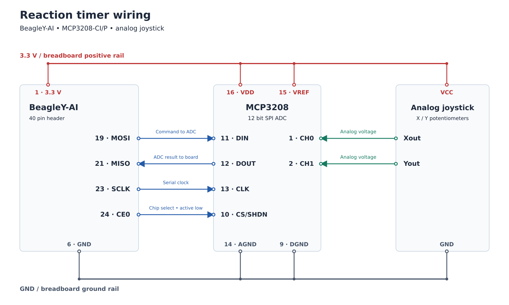
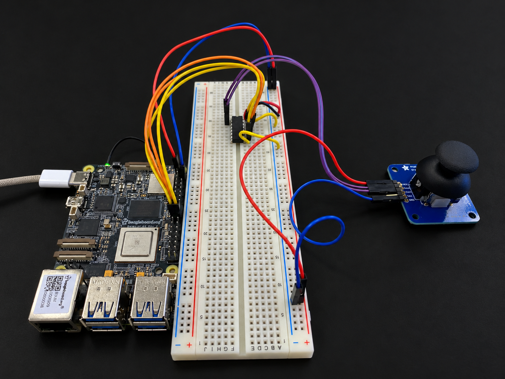

# Embedded Linux Reaction Timer

### Technologies Used

C · Embedded Linux · BeagleY-AI · SPI · MCP3208 · CMake · SSH · NFS

### Overview

This was my first embedded Linux project: a joystick reaction game built on a BeagleY-AI running Debian Linux.

The rules are simple. Green means push UP, and red means push DOWN. The program gives a random LED cue, measures the player's response time, and keeps their fastest correct result for the session.

Getting there meant connecting the hardware, setting up a Debian development environment, and building C code to run on the board.

The source code is private at my instructor’s request. This repository contains the project overview, wiring diagram, hardware photos, and demo video.

[Watch the reaction timer demo](LinuxReactionTimerDemo_GitHub.mp4)

### Hardware and Tools

- **BeagleY-AI:** Runs the application and controls the LEDs.
- **Analog joystick:** Provides X and Y voltages.
- **MCP3208 12-bit ADC:** Converts those voltages into digital readings.
- **Breadboard and jumper wires:** Connect the hardware.

I wrote the application in C, using CMake for the build, Linux spidev to communicate with the ADC, and sysfs to control the onboard LEDs. My development environment was a Debian VM running in UTM on a Mac. I used SSH to access the board and NFS to share the executable.

### How the Game Works

Each round begins with alternating green and red flashes. If the player is holding UP or DOWN, the game waits until they release the joystick.

After a random delay of 500 to 3000 milliseconds, the program checks for an early UP or DOWN input. If it detects one, it prints “Too soon!” and starts the round again.

Otherwise, it randomly chooses a direction, turns on the corresponding LED, and starts timing.

A correct response prints the reaction time and produces five green flashes. An incorrect response produces five red flashes.

Moving LEFT or RIGHT when responding to the cue exits the game. The session also ends if the player takes more than five seconds to respond.

### Reading the Joystick

The joystick's X and Y outputs connect to channels 0 and 1 of the MCP3208. The program reads both channels over SPI, receiving values from 0 to 4095.

I used thresholds of 800 and 3300 to translate those readings into directions. Values from 800 through 3300, inclusive, count as neutral for that axis. The program checks X first, so horizontal movement takes priority if the player moves diagonally.

The joystick module handles the ADC readings and SPI communication. It passes a direction to the game, which decides how to respond.

### Software Structure

I split the program into three parts: the game, joystick, and LEDs.

The game manages each round and measures response times. The joystick module reads movement, and the LED module handles the visual feedback. This keeps the hardware details separate from the game logic.

### Development Setup

I followed setup guides to configure the Debian VM, USB networking, SSH, and NFS.

The VM cross-compiles the program for the Beagle board. CMake brings the application, joystick, and LED modules together, and the build then copies the executable into the host's shared folder.

The board accesses that folder through its NFS mount at `/mnt/remote`. From there, I use SSH to run the executable on the board.

The host and target paths point to the same shared file. Whenever I change the source code, I rebuild it before running the updated program.

### Problems I Worked Through

**Learning to use Linux**

Linux was new to me, and even the basics took time. Moving between folders, running commands, and keeping track of saved files all required explanations and practice.

I also had to remember which machine I was working on: the Debian VM or the Beagle board. Following guides and working through errors with help gradually made the setup easier to understand.

**Getting SPI working**

At first, the SPI device needed to read the ADC wasn't available in Linux. I had to work through what was missing and how to enable it.

Following the setup instructions, I changed the board's startup settings and rebooted. After that, `/dev/spidev0.0` appeared, giving the program access to the ADC.

**Getting the shared folder working**

The shared folder between the VM and board took several attempts to get working. I needed help understanding the setup and the errors along the way.

The board was missing software required to access the folder. Installing it and working through the network setup eventually allowed the board to access the program built on the VM.

**Program not found at login**

During rehearsal, the board tried to launch the game but couldn't find the program. I had already built it, so the error wasn't immediately obvious.

I traced the issue to the shared folder being unavailable on the board. Running the script that reconnects it restored access to the executable.

These problems took repeated attempts and explanations to resolve. Alongside learning the code, I was learning how the development setup worked and how its different parts depended on each other.

### Testing

I tested the application on the physical board during development and rehearsal, checking the following behaviour:

- **Correct direction:** Green feedback and a displayed response time.
- **Incorrect direction:** Red feedback.
- **UP or DOWN held through preparation:** Wait until the joystick is released.
- **UP or DOWN held at the early-input check:** Restart the round.
- **No response:** Exit after the timeout.
- **LEFT or RIGHT at the response cue:** Exit normally.
- **Faster correct response:** Update the best time.
- **Slower correct response:** Keep the previous best time.

The recorded terminal session shows a correct response, an incorrect response, and an exit using the joystick. I checked the remaining cases manually during rehearsal.

### What I Learned

This project helped me understand how C code interacts with physical hardware through Linux.

I worked through the path from joystick voltages to ADC readings, then through SPI to the program's direction checks. Reviewing the code also helped me make sense of pointers, enums, file descriptors, and the state shared within each module.

Keeping track of the VM and board became easier with practice. Checking the terminal hostname helped me confirm where I was running commands and which files that machine could access.

### Current Limits

The program detects responses by polling, so Linux scheduling and the time needed to read the joystick affect the measured reaction time. A five-millisecond polling pause does not guarantee five-millisecond timing accuracy.

The direction thresholds are fixed. The program checks for early input only once, after the random delay, so it can miss a brief movement that has already been released.

The best time is kept only for the current session and resets when the application closes.

The build copies the executable to my NFS shared folder. Anyone adapting the build setup would need to change that destination to match their own environment.

### Acknowledgments

Rodrigo Villalon

Developed for SFU ENSC 351 using the supplied starter material and technical guides. AI tools helped with troubleshooting and explanations.
